<div align="center">


<br/>

[](https://github.com/CodeWithMir/Understudy/actions/workflows/ci.yml)


### Gemini watches you do a task once - and hands back automation that obeys your rules and proves it worked.

[**Live demo**](#-links) · [**Demo video**](#-links) · [**Pitch deck**](docs/Understudy_Pitch_Deck.pdf) · [Architecture](ARCHITECTURE.md) · [Full guide](docs/GUIDE.md) · [Benchmark](docs/BENCHMARK.md)

<sub>Google Cloud AI Builder Cup 2026 · Future of Work &amp; Enterprise Productivity · Team JAAAR</sub>

</div>

---

<table>
<tr>
<td width="33%" valign="top">

**🎥 In:** a screen recording of someone doing the job, the app's address, and the SOP in plain language - any language.

</td>
<td width="33%" valign="top">

**🧠 Middle:** Gemini understands the video, turns the SOP into enforced rules, writes the code, runs it, and heals it when the UI changes.

</td>
<td width="33%" valign="top">

**📦 Out:** a tested, governed ZIP - readable code, data, rules that travel with the script, and evidence of a real, verified run.

</td>
</tr>
</table>

## 🎭 The story in four scenes


<details>
<summary><b>🎟️ Open the playbill - who plays which part</b></summary>
<br/>
</details>

## 🎬 Watch the performance

<div align="center">
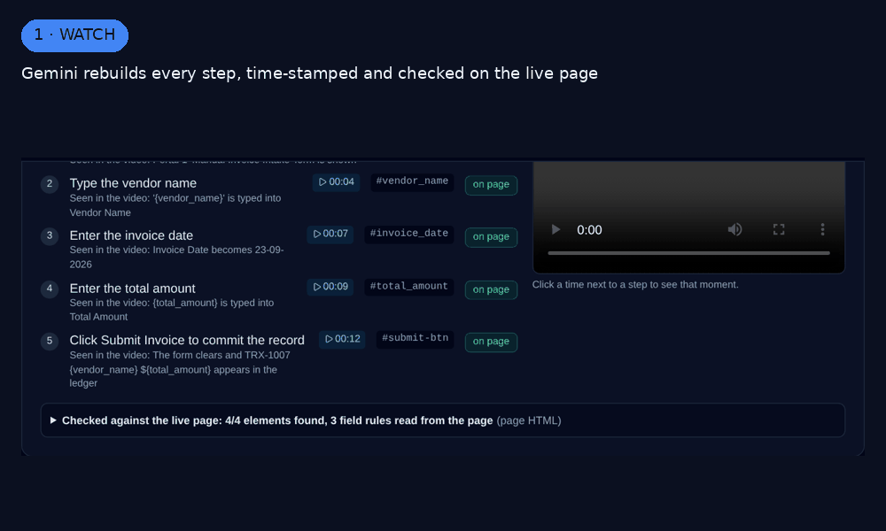
<br/><sub>Captured from the running product: Watch → Govern → Build → Execute → Export, plus Model Armor and Mission Control.</sub>
</div>

## ⏱️ The 60-second tour for judges

| Criterion | Weight | Where to look |
|---|---|---|
| **Technical Merit & Gen AI** | 40% | 28 Gemini prompts in one registry → [`core/wizard/prompts.py`](core/wizard/prompts.py), verbatim in [ARCHITECTURE.md §8](ARCHITECTURE.md) · multimodal video understanding → [`watch.py`](core/wizard/watch.py) · build agent that proves locators on the live page → [`build_agent.py`](core/wizard/build_agent.py) · run-time Gemini agent → [`agent_runtime.py`](core/wizard/agent_runtime.py) · 855 tests → [`tests/`](tests) |
| **Problem Alignment & Impact** | 25% | [The problem](#-the-problem) · [Measured results](#-measured-not-claimed) · ledger-verified benchmark → [`scripts/benchmark.py`](scripts/benchmark.py) |
| **Innovation & Creativity** | 25% | [What makes it different](#-what-makes-it-different) · SOP rules shipped *inside* every generated script → [`governance_runtime.py`](core/wizard/governance_runtime.py) · difficulty score that routes traditional vs agentic |
| **User Experience & Design** | 10% | [Scenes](#scenes) · five guided steps, video-timed evidence, one-click fixes, light/dark themes, separate admin console |
| **Deployed on Google Cloud** | required | [`deploy_cloudrun.sh`](deploy_cloudrun.sh) · [`scripts/check_deployment.py`](scripts/check_deployment.py) checks the live URL against the submission rules |

## 🧱 The problem

Enterprise processes live in people's heads. Automating one - invoice entry, onboarding, data entry - takes a
specialist, weeks of scripting, and a PDF of rules nobody enforces. Today's options trade one risk for another:
**recorders are brittle, hand-written scripts are slow, and free-roaming AI agents act without guardrails or proof.**

| Wall a developer hits | What Understudy does |
|---|---|
| *Where do I start?* Which tool, version, install? | Watches the recording, scores difficulty, recommends a tool - or an AI agent |
| *Writing the script:* brittle selectors, hard-coded data | Proves every selector on the live page; every value lives in `payload.json` |
| *Business rules* live in a document | SOP becomes confirmed rules that **block** a non-compliant run |
| *"It ran, so it worked"* - exit 0, nothing saved | Step-by-step evidence; the benchmark checks the target's own ledger |
| *It broke* after a UI release | Gemini diagnoses, shows the fix as a diff, re-runs after approval, **remembers** |

## 🔁 How it works - a play in five acts

Five gated steps. A step cannot start until the previous one passes, and the download is refused until all five do.
**Gemini understands; deterministic checks decide.**

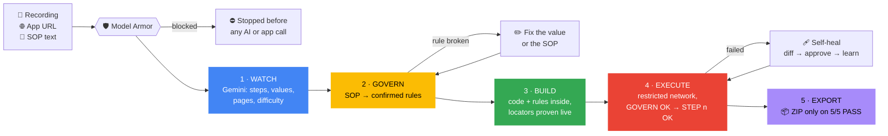

<details>
<summary><b>🩹 What happens when the app's UI changes (self-healing, step by step)</b></summary>

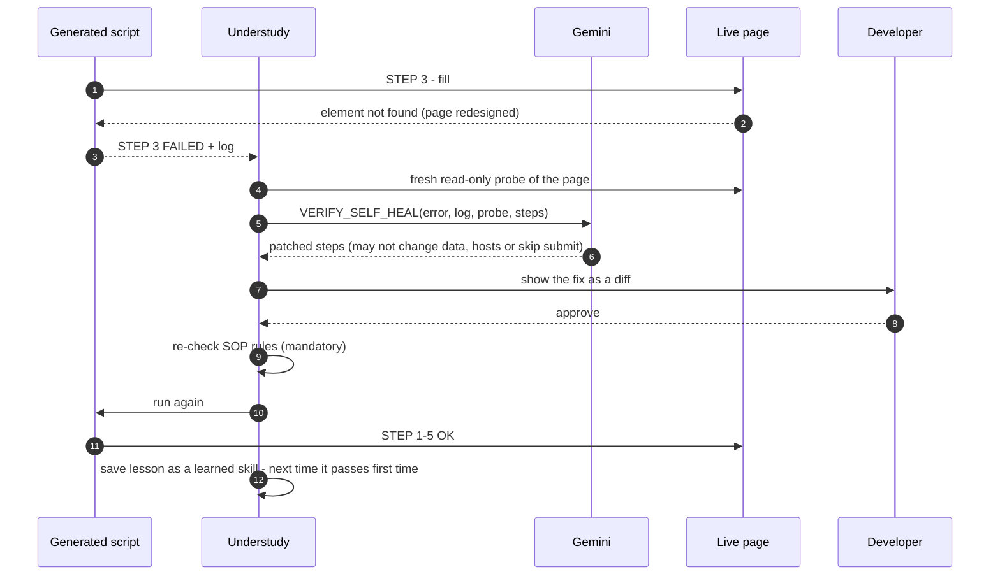

</details>

<a id="scenes"></a>

## 🖥️ Scenes from the show

<table>
<tr>
<td width="50%"><b>Act I · Watch</b> - every step time-stamped to the video and checked on the live page<br/>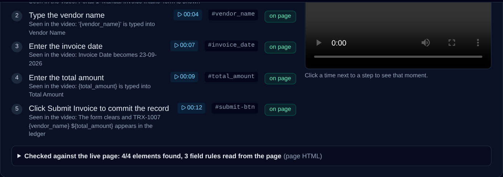</td>
<td width="50%"><b>Act I · Watch</b> - Automation Difficulty Score routes traditional vs agentic<br/>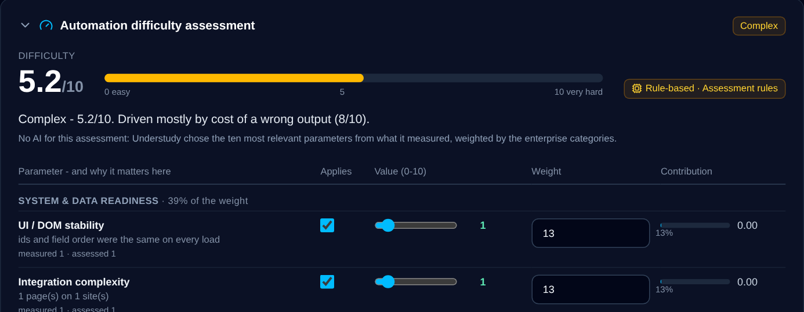</td>
</tr>
<tr>
<td><b>Act II · Govern</b> - "$5,000 spend limit" blocks a $7,500 invoice before anything runs<br/>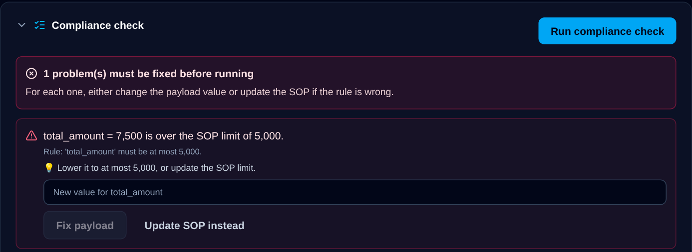</td>
<td><b>Act II · Govern</b> - fixed in place; rules confirmed; payload complies<br/>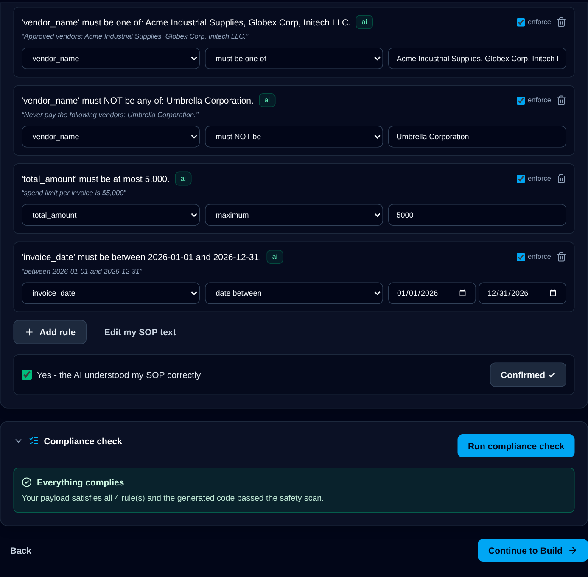</td>
</tr>
<tr>
<td><b>Act III · Build</b> - readable code with the SOP rule check built in<br/>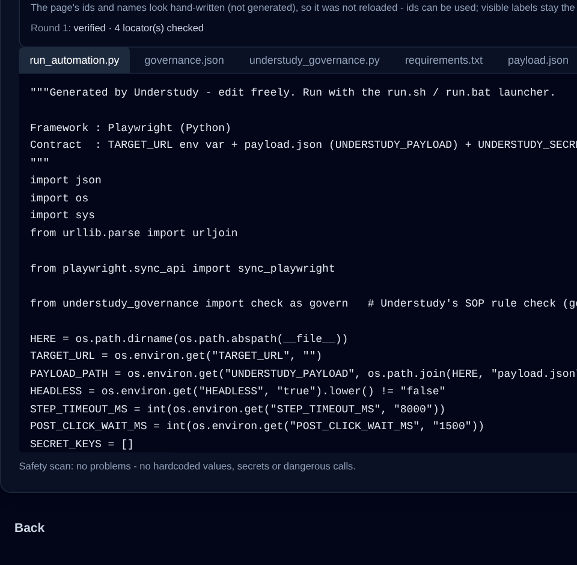</td>
<td><b>Act IV · Execute</b> - <code>GOVERN OK</code> → <code>STEP 1-5 OK</code> → complete, on a restricted network<br/>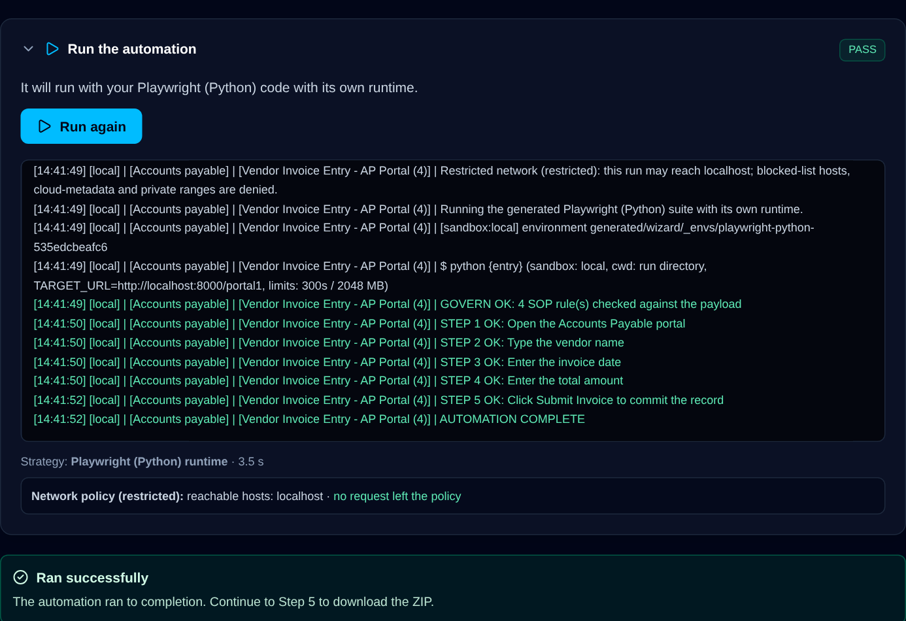</td>
</tr>
<tr>
<td><b>Act V · Proof</b> - the record really is in the target app's ledger<br/>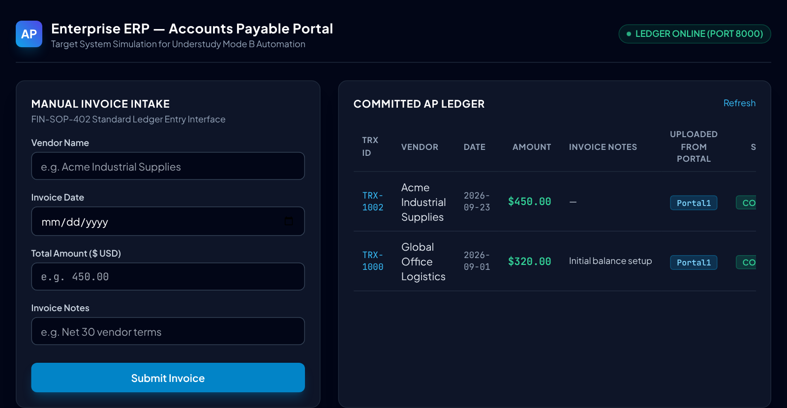</td>
<td><b>Act V · Export</b> - code, data, rules and evidence in one ZIP<br/>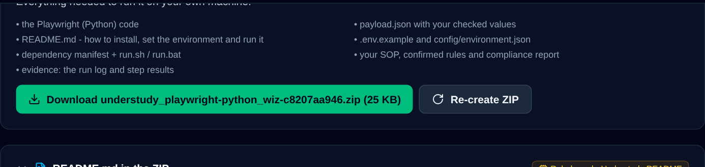</td>
</tr>
<tr>
<td><b>🛡️ Model Armor</b> - a prompt injection hidden in the SOP is stopped in Step 1<br/>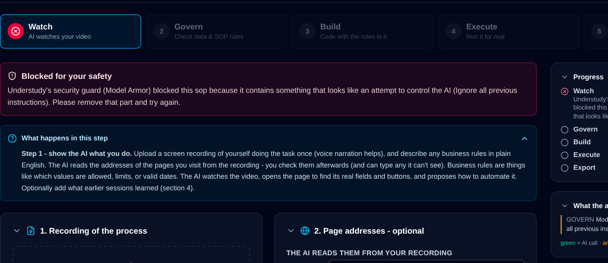</td>
<td><b>🎛️ Mission Control</b> - every user action and every Gemini call, visible to the admin<br/>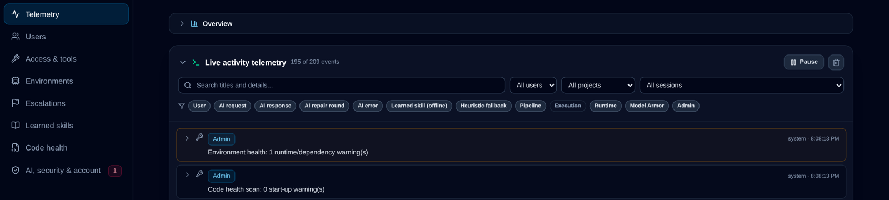</td>
</tr>
</table>

## ✨ What makes it different

| | Classic RPA recorder | Free-roaming AI agent | **Understudy** |
|---|---|---|---|
| Learns the task from | A recorded click path | A text prompt | **Video + narration + live page + SOP** |
| Business rules | Not enforced | Hoped for in the prompt | **Confirmed rules shipped inside every script** |
| Proof it worked | Exit code | "Done" | **Step log + target ledger check** |
| When the UI changes | Breaks | Improvises, unaudited | **Heals with an approved diff, then learns** |
| Picks the approach | Always scripted | Always agentic | **Difficulty score picks traditional or agentic** |
| Admin control | Per-bot licences | Little | **Tools, sites, versions, network, telemetry** |

**Six ideas we think are new together:**

1. **Video → governed code.** Multimodal Gemini reads frames *and* narration, and every step links back to its moment in the video as evidence.
2. **Rules that travel.** `governance.json` + a fixed checker ship inside every generated suite - the SOP is enforced wherever the ZIP runs, not just in our UI.
3. **Grounded, not guessed.** Every selector Gemini proposes is verified on fresh loads of the real page before a single run.
4. **Right tool for the job.** An *Automation Difficulty Score* (ten parameters Gemini picks for this process) decides between a generated script and a run-time Gemini agent.
5. **Heals, then remembers.** Validated fixes and answers become *learned skills* - the next run passes first time, even offline or out of quota.
6. **Measured, not claimed.** The benchmark checks the target system's own ledger, independently of the product.

## 🧠 Gemini at the core

Gemini, through Google's **Gen AI SDK (`google-genai`)** on **Vertex AI**, does real work in every step - **28 prompts**,
each with a schema-validated output and a deterministic fallback, all visible in Mission Control's telemetry.

| Step | Gemini's job | Prompts |
|---|---|---|
| 👁️ Watch | Multimodal understanding (frames + narration + page inventory + SOP); page discovery; difficulty and routing | `WATCH_ANALYZE` `WATCH_URLS` `WATCH_REFINE` `AUTOMATION_DIFFICULTY` `AUTOMATION_ROUTING` `INSPECTION_PLAN` |
| 🛡️ Govern | Prose → structured rules; semantic injection guard | `GOVERN_EXTRACT_RULES` `GOVERN_COMPLIANCE_REVIEW` `MODEL_ARMOR_CLASSIFIER` |
| 🔨 Build | Code for any approved tool, or an agentic script | `BUILD_GENERATE_SUITE` `BUILD_PARAMETERIZE` `AGENTIC_SCRIPT` `FRAMEWORK_RESOLVE` |
| ▶️ Execute | Drives the page live (agentic mode); heals failed runs | agent step decisions · `VERIFY_SELF_HEAL` `RUNTIME_REPAIR` |
| 🎛️ Admin | Installs and smoke-tests new tools; fixes its own start-up warnings | `TOOL_SETUP_PLAN` `SETUP_AGENT_STEP` `TOOL_SMOKE_TEST` `CODE_HEALTH_FIX` |

## ☁️ Architecture on Google Cloud

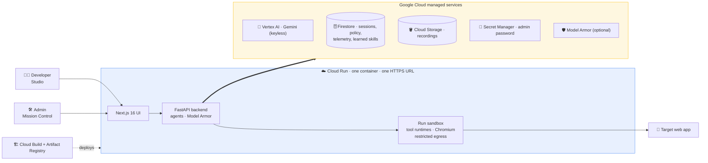

Least-privilege service account · state shared across instances through Firestore · one script builds, deploys and
checks the live URL. Details: [ARCHITECTURE.md §12](ARCHITECTURE.md).

## 📊 Measured, not claimed

`python scripts/benchmark.py` drives the real product end to end against the bundled demo ERP and checks the ERP
ledger itself after every run.

| Scenario | Result | Median end-to-end |
|---|---|---|
| Clean AP form | ✅ 3/3 - record in the ledger exactly once | 3.78 s |
| Redesigned portal (other ids, labels, upload) | ✅ 3/3 | 3.77 s |
| Selector drift (app redesigned after recording) | ✅ 3/3 - healed itself, then passed first time from a learned skill | 3.83 s |
| Over-limit invoice | ✅ 3/3 blocked by Govern - **0 ledger changes** | 0.22 s |
| Model Armor | ✅ 10/10 attacks blocked, 0 false positives on 10 benign SOPs | 0.08 ms / input |

<sub>Run in offline heuristic mode (no Gemini in the benchmark environment); with Gemini the same command measures the AI path. Tool coverage: <a href="docs/TOOL_MATRIX.md">docs/TOOL_MATRIX.md</a>.</sub>

## 🚀 Quick start

<details open>
<summary><b>Deploy to Google Cloud Run (one command)</b></summary>

```bash
./deploy_cloudrun.sh <project-id> [region]       # Windows: deploy_cloudrun.bat <project-id> [region]
```

Enables the APIs, creates Firestore, the recordings bucket, Artifact Registry, a least-privilege service account and
the admin password in Secret Manager, builds with Cloud Build, deploys, then verifies the live URL with
`scripts/check_deployment.py`.

</details>

<details>
<summary><b>Run locally</b></summary>

```bash
cp .env.example .env              # optional: GEMINI_API_KEY=...  (without it: offline mode)
./run_demo.sh                     # Windows: run_demo.bat
```

| Screen | URL |
|---|---|
| Understudy Studio (developers) | http://localhost:3000/wizard |
| Mission Control (admins) | http://localhost:3000 |
| Demo ERP targets | http://localhost:8000/portal1 · `/portal2` · `/portal3` |

Try it: create a project and a session → tick **Use the sample invoice-entry video** → **Portal 1** → **Load example**
→ **Analyse**. Connect Vertex AI, Firestore and Cloud Storage to a local install with
`./scripts/gcp_setup.sh <project-id>`; Docker: `./deploy_docker.sh`. Everything else: [docs/GUIDE.md](docs/GUIDE.md).

</details>

<details>
<summary><b>Run the tests and the benchmark</b></summary>

```bash
pip install -r requirements-dev.txt
python -m pytest                         # 855 tests
python scripts/benchmark.py              # end-to-end, checks the ERP ledger itself
python scripts/tool_matrix.py --live     # every catalog tool, real installs and runs
```

</details>

## 🗺️ Repository map

```
server.py              FastAPI app: wizard, admin, auth, demo ERP, health
core/wizard/           the engine - watch, governance, build agent, executor, self-healing,
                       Model Armor, Gemini transport, 28-prompt registry, store (local / Firestore)
understudy-ui/         Next.js 16 UI - Studio (/wizard) and Mission Control (/)
erp/                   demo ERP portals used as automation targets
scripts/               benchmark, tool matrix, GCP setup, deployment check, demo recorder
tests/                 855 unit, integration and end-to-end tests
docs/                  guide, benchmark, tool matrix, pitch deck, screenshots, assets
.github/               CI (tests, UI build, Cloud Run image), Dependabot, issue and PR templates
deploy_cloudrun.*      one-command Cloud Run deployment (bash, PowerShell, batch)
```

## 🧭 Roadmap

- [x] Watch → Govern → Build → Execute → Export on Cloud Run, traditional and agentic
- [x] Mission Control, Model Armor, learned skills, self-healing with approval
- [ ] Each run as its own Cloud Run job behind a VPC egress firewall
- [ ] SSO / OIDC and Identity-Aware Proxy
- [ ] Vertex AI embeddings for learned-skill and history search
- [ ] Desktop and API processes beyond the browser; scheduled runs; shared process library
- [ ] Agent Platform integration for governed agent fleets

Known limitations are listed openly in [ARCHITECTURE.md §11](ARCHITECTURE.md). Security model: [SECURITY.md](SECURITY.md).

## 🔗 Links

| | |
|---|---|
| Live prototype (Cloud Run) | *to be added* |
| Demo video (under 3 minutes) | *to be added* |
| Pitch deck | [docs/Understudy_Pitch_Deck.pdf](docs/Understudy_Pitch_Deck.pdf) |

## 👏 Curtain call - Team JAAAR

*Just Another Agentic AI Researcher* - built for the **Google Cloud AI Builder Cup 2026**.

| | |
|---|---|
| **Mir Jasimuddin** | [@CodeWithMir](https://github.com/CodeWithMir) |
| **Aarya Dutta** | |

<div align="center"><sub>Contributions welcome - see <a href="CONTRIBUTING.md">CONTRIBUTING.md</a>.</sub></div>
